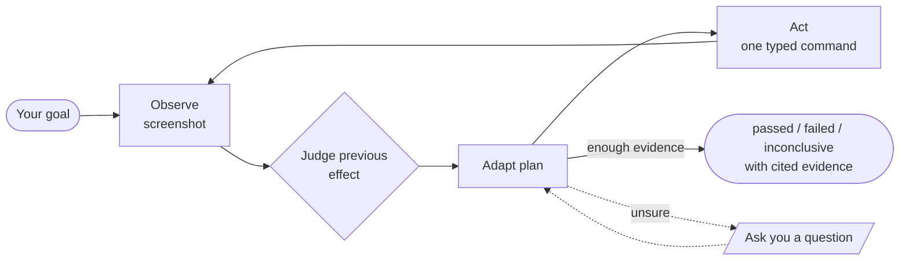

<div align="center">

# Visto

**V**isual **I**ntelligent **S**martphone **T**est **O**perator

**Describe a mobile test in plain language. An AI looks at the screen, taps through
your app and tells you whether it actually works.**

No selectors. No page objects. No brittle scripts that break when a button moves.

[](LICENSE)


[](CONTRIBUTING.md)



<sub>Illustration of a run against a fictional app. The flow and outcome format match what Visto records.</sub>

</div>

> [!WARNING]
> **Visto is a work in progress.** Android works end to end today: CLI, web
> console, Docker setup. **iOS is implemented but has only had local checks** (see
> [platform support](#platform-support)). APIs, prompts and storage
> formats may still change. Early testers and contributors are very welcome.

## Why Visto?

Traditional mobile end-to-end tests describe *how* to click: element IDs, XPath,
waits, retries. They break whenever the UI changes, and a green run only shows
that the clicks happened.

Visto starts from the *goal*:

```text
Goal:            Create a note titled "Groceries".
Expected result: The note appears at the top of the list.
Constraints:     Do not delete existing notes.
```

One multimodal AI conversation then takes over:

1. **Observe**: take a fresh screenshot of the real device.
2. **Judge**: did the previous action have the intended effect?
3. **Plan**: adjust the plan to what is actually on screen.
4. **Act**: issue one typed command (tap, swipe, type, back…), or wait, or ask you a question.
5. **Conclude**: `passed`, `failed` or `inconclusive`, with a short explanation that
   cites the observations it relied on.



## What you can do with it

| | |
|---|---|
| 🎯 **Goal-driven tests** | Describe goal, expected result and constraints in natural language, or **dictate** them by voice. |
| 👀 **Vision first** | The AI reasons on screenshots like a human tester, so tests survive layout changes, redesigns and A/B variants. |
| ⚖️ **AI-owned verdicts** | A successful tap never counts as a successful test. The AI judges every effect and decides the semantic outcome. |
| 🧾 **Traceable evidence** | Every decision is linked to the screenshots that led to it. Export runs as **HTML or JSON reports**. |
| 🛑 **Distinct outcome types** | Product failure, insufficient evidence, device/provider infrastructure failure and user cancellation are kept apart. |
| 🎛️ **Live control** | Pause, resume or cancel a run, and answer the AI's questions from the **web console**. |
| 💸 **Budgets and costs** | Hard caps on wall time, actions and inferences. Run statistics with cost estimates from daily-updated prices. |
| 🔒 **Safe by design** | The AI cannot reach a shell, only typed, timeout-bound device commands. One owner per device. Uncertain mutations are never retried blindly. |
| 🐳 **One-command setup** | Backend, console, Appium and adb all run in Docker. |

## Platform support

| Platform | Status | Device backend |
|---|---|---|
| **Android** | ✅ Working (8.0 / API 26+, USB or wireless debugging) | Appium + UiAutomator2, adb |
| **iOS** | 🚧 Implemented, local checks only: nothing has been run against a simulator or a device yet. Native macOS only; see [iOS setup](docs/ios-setup.md) | Appium + XCUITest, WebDriverAgent |

The core is platform-agnostic by design. The domain and application layers know
about *observations* and *commands*, not about Android. The iOS adapter is a second
device adapter behind the same port; the AI loop stays the same. The physical-device
path is code-complete but unobserved.

## Quick start (Docker)

You need Docker (Compose v2), an OpenAI API key with access to a vision model,
and an Android device with USB or wireless debugging enabled. (iOS needs a native
macOS setup instead of Docker: see [iOS setup](docs/ios-setup.md).)

```sh
git clone https://github.com/<your-org>/visto.git
cd visto
cp .env.example .env          # set OPENAI_API_KEY
docker compose up --build -d
```

Open <http://localhost:8080>, pick your device, describe the goal and start the run.

- Connecting a device to the containers (wireless debugging, Linux USB) and the
  VS Code dev container: [Docker and dev container](docs/docker.md)
- Development commands (install, verify, start servers): [local development](docs/local-development.md)
- First run from the terminal CLI: [first device tests](docs/first-device-test.md)
- Web console guide: [web console](docs/web-console.md)

> [!IMPORTANT]
> Screenshots, goals and the AI's reasoning are sent to the configured AI provider
> and stored locally as run history. Use test devices, test accounts and synthetic
> data. See [provider setup](docs/provider-setup.md) and
> [artifact storage](docs/artifact-storage.md).

## Architecture

```text
            React console ─┐        ┌─ CLI
                           ▼        ▼
┌──────────────────── FastAPI / runner ─────────────────────┐
│  adapters   AI provider · Android + iOS (Appium) · SQLite │
│             screenshots · reports · pricing               │
│  ───────────────────────────── ▲ ──────────────────────── │
│  application   one conversational run loop, budgets,      │
│                cancellation, pause/resume, questions      │
│  ───────────────────────────── ▲ ──────────────────────── │
│  domain        immutable runs, observations, commands     │
└───────────────────────────────────────────────────────────┘
```

- **Stack:** Python 3.12 + FastAPI, React + TypeScript (Vite), SQLite, Appium.
- **Clean Architecture:** `domain ← application ← adapters`. The core never imports
  FastAPI, Appium, provider SDKs or database drivers, so a provider, a storage
  engine or a device platform can be swapped.
- **Deliberately absent:** no hard-coded UI predicates, label dictionaries or
  app-specific verification rules. Semantic judgement belongs to the AI; technical
  validity, locks, cancellation and budgets belong to code.

More: [architecture](docs/ai-context/03-architecture.md) ·
[product vision](docs/product/vision.md) · [API contract](docs/api-contract.md) ·
[report export](docs/report-export.md).

## Roadmap

- [x] Conversational AI run loop with AI-owned verdicts
- [x] Android device adapter (Appium/UiAutomator2)
- [x] Terminal CLI, web console, HTML/JSON reports
- [x] Docker stack and dev container
- [x] Voice dictation, run statistics and cost estimates
- [x] iOS device adapter (Appium/XCUITest), implemented with local checks only
- [ ] **Verify iOS** against real simulators and devices
- [ ] Additional AI providers (only OpenAI is wired today)
- [ ] Labelled evaluation suite to measure judgement quality across models
- [ ] CI-friendly headless mode and exit codes for pipelines
- [ ] Optional accessibility-tree observations (as extra data, never as a verifier)
- [ ] Batches of tests and scheduling

## Contributing

**Contributions are very welcome**, and verifying iOS on simulators and devices is the most wanted. Other good
first areas: new AI providers, console UX, documentation, real-world test
scenarios built on fictional sample apps, and an actual screen recording for this
README.

Read [CONTRIBUTING.md](CONTRIBUTING.md) to set up the project, run the checks
(`python scripts/verify.py`) and open a pull request. Bug reports and ideas go in
GitHub issues. Report security issues privately as described in
[SECURITY.md](SECURITY.md).

### Built with AI coding agents

This repository is developed with role-based AI coding agents.
[AGENTS.md](AGENTS.md) and [docs/ai-context](docs/ai-context/00-index.md) hold the
instructions, architecture notes and current status they work from. Human contributors can
ignore them or use them as a map of the codebase.

## License

[MIT](LICENSE) © 2026 Alessandro Oddo and Visto contributors.
