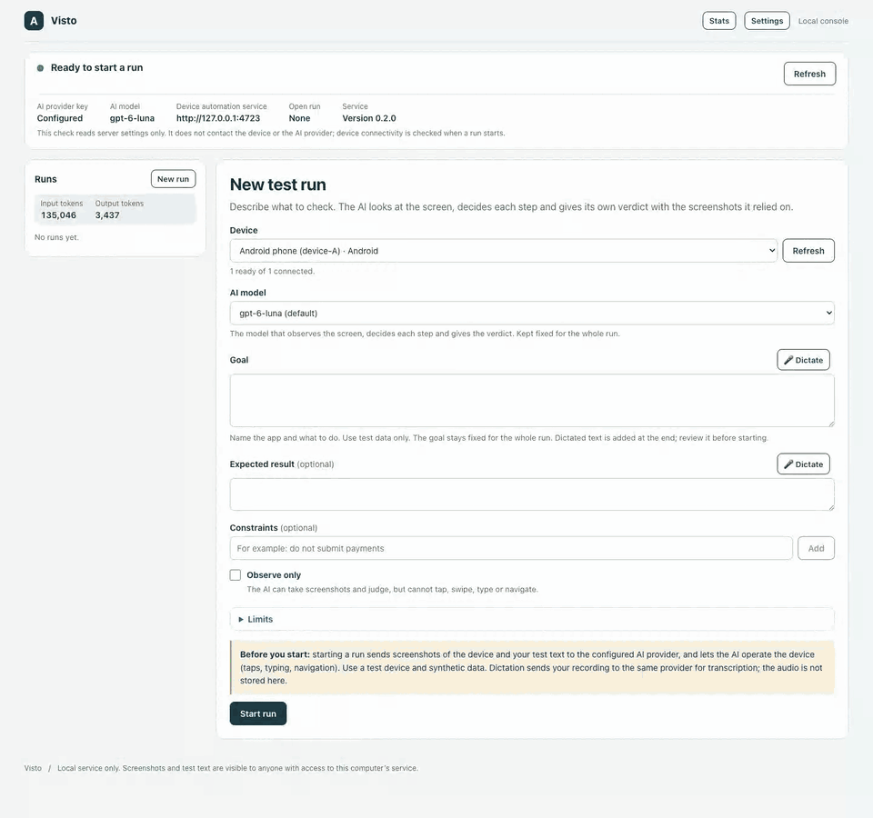

<div align="center">

# Visto

**V**isual **I**ntelligent **S**martphone **T**est **O**perator

**Describe a mobile test in plain language. An AI looks at the screen, taps through
your app and tells you whether it actually works.**

No selectors. No page objects. No brittle scripts that break when a button moves.

[](LICENSE)


[](CONTRIBUTING.md)



<sub>A real run on a USB-connected Android phone, recorded from the web console: one goal, the AI's reasoning as it works, then its verdict. The waiting between steps is sped up 4×.</sub>

</div>

> [!WARNING]
> **Visto is a work in progress.** Android and iOS work end to end today, from
> the CLI and the web console. **iOS needs more setup than Android** (a Mac with
> Xcode and a signed WebDriverAgent; see [Quick start (iOS)](#quick-start-ios)).
> APIs, prompts and storage formats may still change. Early testers and
> contributors are very welcome.

## Why Visto?

Traditional mobile end-to-end tests describe *how* to click: element IDs, XPath,
waits, retries. They break whenever the UI changes, and a green run only shows
that the clicks happened.

Visto starts from the *goal*:

```text
Goal:            Create a note titled "Groceries".
Expected result: The note appears at the top of the list.
Constraints:     Do not delete existing notes.
```

One multimodal AI conversation then takes over:

1. **Observe**: take a fresh screenshot of the real device.
2. **Judge**: did the previous action have the intended effect?
3. **Plan**: adjust the plan to what is actually on screen.
4. **Act**: issue one typed command (tap, swipe, type, back…), or wait, or ask you a question.
5. **Conclude**: `passed`, `failed` or `inconclusive`, with a short explanation that
   cites the observations it relied on.


## What you can do with it

| | |
|---|---|
| 🎯 **Goal-driven tests** | Describe goal, expected result and constraints in natural language, or **dictate** them by voice. |
| 👀 **Vision first** | The AI reasons on screenshots like a human tester, so tests survive layout changes, redesigns and A/B variants. |
| ⚖️ **AI-owned verdicts** | A successful tap never counts as a successful test. The AI judges every effect and decides the semantic outcome. |
| 🧾 **Traceable evidence** | Every decision is linked to the screenshots that led to it. Export runs as **HTML or JSON reports**. |
| 🛑 **Distinct outcome types** | Product failure, insufficient evidence, device/provider infrastructure failure and user cancellation are kept apart. |
| 🎛️ **Live control** | Pause, resume or cancel a run, and answer the AI's questions from the **web console**. |
| 💸 **Budgets and costs** | Hard caps on wall time, actions and inferences. Run statistics with cost estimates from daily-updated prices. |
| 🔒 **Safe by design** | The AI cannot reach a shell, only typed, timeout-bound device commands. One owner per device. Uncertain mutations are never retried blindly. |
| 💻 **Runs on your machine** | Backend, console and Appium run locally: Windows, Linux or macOS for Android, macOS for iOS. |

## Platform support

| Platform | Status | Device backend |
|---|---|---|
| **Android** | ✅ Working (8.0 / API 26+, USB or wireless debugging) | Appium + UiAutomator2, adb |
| **iOS** | ✅ Working on a real iPhone by USB cable (macOS with Xcode only). One-time signing setup required: see [Quick start (iOS)](#quick-start-ios). Simulators are supported but not yet exercised live | Appium + XCUITest, WebDriverAgent |

The core is platform-agnostic by design. The domain and application layers know
about *observations* and *commands*, not about Android. The iOS adapter is a second
device adapter behind the same port; the AI loop stays the same.

## Quick start (Android)

You need:

- [uv](https://docs.astral.sh/uv/getting-started/installation/), the only tool you
  install by hand (it also provides Python);
- an OpenAI API key with access to a vision model;
- an Android 8+ device with USB debugging enabled, connected and authorized.

Copy the wheel URL of the release you want from the
[releases page](https://github.com/alevittoria/visto/releases), then:

```sh
uv tool install https://github.com/alevittoria/visto/releases/download/v<version>/visto-<version>-py3-none-any.whl
uv tool update-shell   # once: puts uv's tool folder on PATH; then open a new terminal
visto start            # first start downloads Node, a JDK, the Android SDK tools and Appium
```

If `visto` is not recognised as a command, the terminal was opened before
`uv tool update-shell`: open a new one. The first `visto start` asks you to accept
the Android SDK license and installs its toolchain into `~/.visto`; later starts
reuse it. Visto installs nothing system-wide and changes no environment variable;
Android Studio is not needed. `start` runs Appium and opens the console at
<http://127.0.0.1:8000/>. While no provider key is configured, the console opens on
its Settings page: paste the API key there, then pick your device, describe the
goal and start the run. `visto doctor` checks the setup when something does not
work.

- Full installation guide, proxies, upgrade and uninstall:
  [installation](docs/local-development.md)
- Device preparation and wireless debugging: [Android setup](docs/android-setup.md)
- iOS simulators and iPhones (macOS only): [Quick start (iOS)](#quick-start-ios)
- First run from the terminal CLI: [first device tests](docs/first-device-test.md)
- Web console guide: [web console](docs/web-console.md)

## Quick start (iOS)

iOS takes more preparation than Android, because Apple only lets a phone be driven
through **WebDriverAgent**, a small test app that you sign with your own Apple
account and install on the phone. Visto cannot do that step for you. Plan about
half an hour the first time; afterwards a run starts like on Android.

You need:

- a **Mac** with **Xcode** installed and opened once (it accepts its license and
  installs its components);
- an **Apple ID** added in Xcode (Settings › Accounts); a free personal team is
  enough;
- for a physical phone, a **USB cable**: the phone is reached only by cable, not
  over Wi-Fi;
- Visto installed as in the [Android quick start](#quick-start-android). On a Mac,
  the first `visto start` also installs the iOS driver.

A **simulator** needs no signing: boot it from Xcode (or
`xcrun simctl boot <simulator-id>`), then pick it in the console. Steps 1–4 below
are for a **physical iPhone**.

**1. Prepare the phone (once).** Connect it by cable, unlock it and tap *Trust*
when it asks to trust the Mac. Turn on **Developer Mode** (Settings › Privacy &
Security › Developer Mode; the phone restarts and asks you to confirm) and
**UI Automation** (Settings › Developer).

**2. Build and install WebDriverAgent (once, then again when the signature expires).**

1. Run `visto doctor` (or open the console's Settings page) and note the
   **WebDriverAgent project** path. Open that `.xcodeproj` in Xcode.
2. Select the `WebDriverAgentRunner` target › *Signing & Capabilities*: choose your
   team and change the bundle identifier to one unique to you, for example
   `com.<yourname>.WebDriverAgentRunner`. Choose the same team for
   `WebDriverAgentLib`.
3. Pick the `WebDriverAgentRunner` scheme and your phone as destination, then run
   **Product › Test**. Stop it once the runner app is installed on the phone.
4. On the phone, trust your developer certificate: Settings › General › VPN &
   Device Management › *Apple Development: …* › **Trust**.

**3. Tell Visto how WebDriverAgent was signed.** In the console's **Settings ›
iOS signing** (shown only on macOS), fill in and save:

| Field | Value |
|---|---|
| Development team ID | your team ID (Xcode › Settings › Accounts) |
| Signing identity | `Apple Development` (not the full certificate name) |
| WebDriverAgent bundle ID | the bundle identifier you chose in step 2 |
| Use a prebuilt WebDriverAgent | ticked |
| Derived data folder | the `~/Library/Developer/Xcode/DerivedData/WebDriverAgent-…` folder of that build |

**4. Start Visto and run.** `visto start` asks for your Mac **administrator
password once**: on macOS it opens the tunnel through which Appium reaches iPhones
with iOS 17 or later, and that needs root. (`--no-ios-tunnel` skips it, but then only
simulators and Android work.) Before every run, connect the phone by cable, unlock
it and open the app under test in its starting state. Visto neither installs nor
launches apps. Then pick the iPhone in the console and start the run. Do not rotate
or touch the phone while the run is going.

> [!NOTE]
> With a **free** Apple team the signature **expires after seven days**. When runs
> stop starting, repeat step 2 (the same values work) and trust the profile on the
> phone again. Repeat step 2 as well after a Visto release that updates the iOS
> driver: `visto doctor` and the Settings page say when that is needed.

If a run ends with `xcodebuild failed with code 65` or `Unable to launch
WebDriverAgent`, it is almost always the signing setup: an untrusted profile, a
wrong derived data folder or a full certificate name as signing identity. The
[iOS setup guide](docs/ios-setup.md#when-a-run-does-not-start) maps each error to
its fix and covers the tunnel, simulators and recovery in detail.

> [!IMPORTANT]
> Screenshots, goals and the AI's reasoning are sent to the configured AI provider
> and stored locally as run history. Use test devices, test accounts and synthetic
> data. See [provider setup](docs/provider-setup.md) and
> [artifact storage](docs/artifact-storage.md).

## Architecture

```text
            React console ─┐        ┌─ CLI
                           ▼        ▼
┌──────────────────── FastAPI / runner ─────────────────────┐
│  adapters   AI provider · Android + iOS (Appium) · SQLite │
│             screenshots · reports · pricing               │
│  ───────────────────────────── ▲ ──────────────────────── │
│  application   one conversational run loop, budgets,      │
│                cancellation, pause/resume, questions      │
│  ───────────────────────────── ▲ ──────────────────────── │
│  domain        immutable runs, observations, commands     │
└───────────────────────────────────────────────────────────┘
```

- **Stack:** Python 3.12 + FastAPI, React + TypeScript (Vite), SQLite, Appium.
- **Clean Architecture:** `domain ← application ← adapters`. The core never imports
  FastAPI, Appium, provider SDKs or database drivers, so a provider, a storage
  engine or a device platform can be swapped.
- **Deliberately absent:** no hard-coded UI predicates, label dictionaries or
  app-specific verification rules. Semantic judgement belongs to the AI; technical
  validity, locks, cancellation and budgets belong to code.

More: [architecture](docs/ai-context/03-architecture.md) ·
[product vision](docs/product/vision.md) · [API contract](docs/api-contract.md) ·
[report export](docs/report-export.md).

## Roadmap

- [x] Conversational AI run loop with AI-owned verdicts
- [x] Android device adapter (Appium/UiAutomator2)
- [x] Terminal CLI, web console, HTML/JSON reports
- [x] Voice dictation, run statistics and cost estimates
- [x] iOS device adapter (Appium/XCUITest)
- [x] iOS verified against real devices
- [ ] Additional AI providers (only OpenAI is wired today)
- [ ] Labelled evaluation suite to measure judgement quality across models
- [ ] CI-friendly headless mode and exit codes for pipelines
- [ ] Optional accessibility-tree observations (as extra data, never as a verifier)
- [ ] Batches of tests and scheduling

## Contributing

**Contributions are very welcome.** Good first areas: new AI providers, console UX, documentation, and real-world test
scenarios built on fictional sample apps.

Read [CONTRIBUTING.md](CONTRIBUTING.md) to set up the project, run the checks
(`python scripts/verify.py`) and open a pull request. Bug reports and ideas go in
GitHub issues. Report security issues privately as described in
[SECURITY.md](SECURITY.md).

### Built with AI coding agents

This repository is developed with role-based AI coding agents.
[AGENTS.md](AGENTS.md) and [docs/ai-context](docs/ai-context/00-index.md) hold the
instructions, architecture notes and current status they work from. Human contributors can
ignore them or use them as a map of the codebase.

## License

[MIT](LICENSE) © 2026 Alessandro Oddo and Visto contributors.
